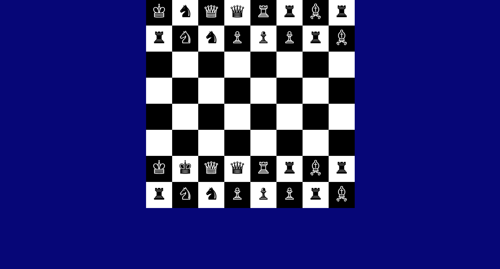

# Chess-Board
After a long time i want to clear my basic that's why i am trying to build a basic project just for my practice and fun.
# ♟️ Chess Board

A simple chess board built using **HTML** and **CSS**. The board is made with `div` boxes in alternating black and white colors, and the chess pieces are placed using **Unicode chess symbols** (HTML entities).

---

## 📸 Output



---

## ✨ Features

- 8 x 8 chess board layout
- Alternating black and white squares
- Chess pieces displayed with Unicode symbols (no images needed)
- Clean and lightweight, only HTML and CSS
- No JavaScript, no external libraries

---

## 🛠️ Tech Stack

| Technology | Use |
|------------|-----|
| HTML5 | Board structure and pieces |
| CSS3 | Styling, grid layout, square colors |

---

## 📂 Project Structure

```
Chess-Board/
│── index.html    # Board structure and pieces
│── style.css     # Styling of the board
│── chess.png     # Output screenshot
│── README.md     # Project documentation
```

---

## 🚀 How to Run

1. Clone the repository
   ```bash
   git clone https://github.com/sneha-goyal7/Chess-Board.git
   ```
2. Open the project folder
   ```bash
   cd Chess-Board
   ```
3. Open `index.html` in your browser (or use **Live Server** in VS Code)

---

## 🧠 What I Learned

- Building layouts with `div` elements and CSS
- Creating alternating patterns using separate classes (`box1`, `box2`)
- Using HTML entities / Unicode symbols to show chess pieces
- Structuring a small project and documenting it

---

## 🔮 Future Improvements

- Make the board fully responsive
- Add piece movement using JavaScript
- Add turn-based gameplay and move validation

---

## 👩‍💻 Author

**Sneha Goyal**
GitHub: [sneha-goyal7](https://github.com/sneha-goyal7)

---

⭐ If you like this project, give it a star!